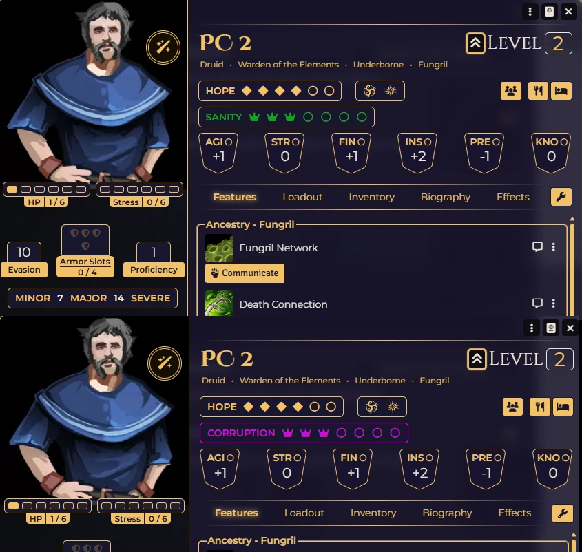
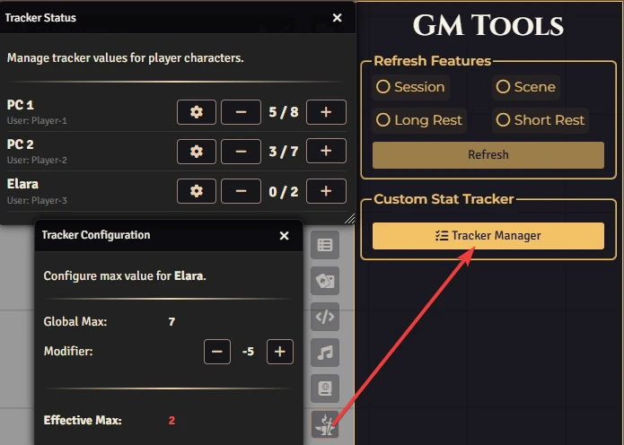
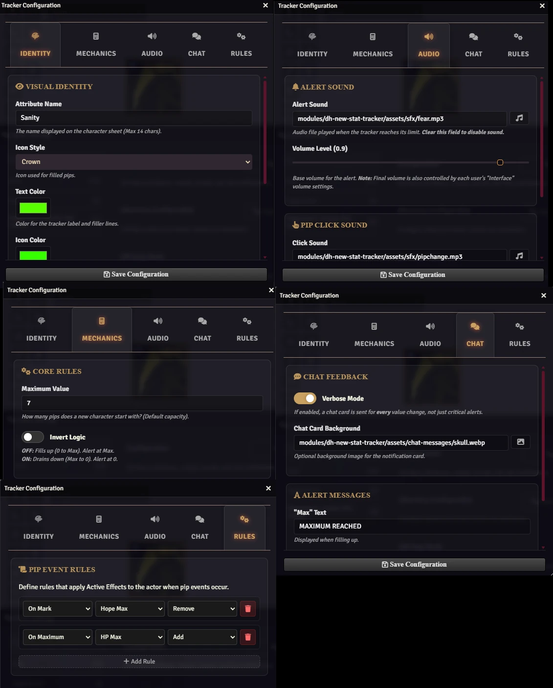

# Daggerheart: Custom Stat Tracker

Some campaigns need a resource the game does not have: Despair, Sanity, Corruption, a curse that grows every session. This module adds it to the character sheet as a row of pips you click to mark.

You can run up to two of these trackers per character, and one for adversaries. Each has its own name, icon, color and maximum. Reaching the maximum plays a sound and sends the GM a chat card, and rules can change Hope, HP, Stress, Evasion and other values as pips are marked.

<p align="center">
  
</p>

[](https://buymeacoffee.com/mestredigital) [](https://mestredigital.online/pages/projetos-en)

# What it does

Each character can show up to two trackers, such as Despair and Corruption. They are independent and each one can be turned on or off. Tracker 1 is on by default and Tracker 2 is off. When both are on, they are stacked one below the other on the sheet.

A left click on a pip marks up to it, and a right click removes one. Each tracker has its own name, one of 74 icons, a color for the text and another for the icons, and a maximum value. On the official sheet you can also give it its own background and border colors.

When a tracker reaches its maximum, the module plays a sound and whispers a chat card to the GM. An inverted tracker counts down instead and alerts when it reaches zero. With verbose mode on, every change also goes to the GM's chat.

Rules change the character's numbers as the tracker moves. A rule runs when a pip is marked, unmarked, or when the tracker reaches its maximum or minimum, and it adds or removes 1 from Hope max, HP max, Stress max, Scars, Evasion, or the bonus to spellcast rolls. The change is an Active Effect on the character, and it is undone when the tracker moves back.

Adversaries have their own tracker with separate settings. Only the GM sees it. Its rules change Stress, HP, the attack roll bonus, the critical threshold, physical or magical damage, and the Major and Severe thresholds.

The GM can hide a tracker from players for everyone, or per character, and can turn on **GM Only Mode** so that players cannot change the values on their own sheets.

The trackers work on the official Daggerheart character and adversary sheets and on the character sheet of [Nice Sheets](https://github.com/brunocalado/dh-nice-sheets), where they show in the sidebar next to its resource tracks.

# How to use it

Open the Tracker Manager with the **Tracker Manager** button in the Daggerheart menu. It lists the characters of every player, and for each tracker lets you raise or lower the value, change that character's maximum, and choose whether players and the GM see it.

<p align="center">
  
</p>

You can also open it with a macro.

```js
DHStatTracker.openManager();
```

## Macro to modify actors

```js
DHStatTracker.updateActor({value: 1}); // Increments the tracker of the selected token by 1.
```

```js
DHStatTracker.updateActor({value: -1});  // Decrements the tracker of the selected token by 1.
```

By default the macro targets Tracker 1. Use the optional `tracker` property (`1` or `2`) to target the second tracker.

```js
DHStatTracker.updateActor({value: 1, tracker: 2}); // Increments Tracker 2 of the selected token by 1.
```

# Settings

Go to **Settings**, then **Configure Settings**, **Module Settings** and **Daggerheart: Custom Stat Tracker**.

<p align="center">
  
</p>

| Setting | Purpose |
| :--- | :--- |
| **Open Tracker 1 Settings** | Configures the first character tracker. On by default. |
| **Open Tracker 2 Settings** | Configures the optional second character tracker. It is off by default: turn on **Enable this Tracker** in the **Identity** tab to use it. |
| **Open Adversary Tracker Settings** | Configures the adversary tracker. |
| **GM Only Mode** | Only the GM can change tracker values on the sheets. |

Each character tracker has its own name, icon, colors, maximum value, sounds, chat alerts, visibility and rules. To turn a tracker off completely, open its settings and turn off **Enable this Tracker** in the **Identity** tab.

# Installation

It needs Foundry VTT v14 and the Daggerheart system 2.10.13 or later.

1. Copy this link:

```
https://github.com/brunocalado/dh-new-stat-tracker/releases/latest/download/module.json
```

2. Open Foundry VTT.
3. Go to the **Add-on Modules** tab and click **Install Module**.
4. Paste the link into the **Manifest URL** box and click **Install**.

# License

* **Code License:** GNU GPLv3.

* **SFX:** This module uses the sound effects from Pixabay. The audio is provided under the Pixabay Content License, which grants a non-exclusive, worldwide, and royalty-free right to use, modify, and distribute the content for digital and commercial purposes. No attribution is legally required under these terms, but it is provided here for transparency and compliance. [fear](https://pixabay.com/pt/sound-effects/horror-quot-panic-fear-quot-sound-effect-479998/) and [pipchange](https://pixabay.com/pt/sound-effects/tecnologia-new-notification-032-480570/)

**Disclaimer:** This module is an independent creation and is not affiliated with Darrington Press.

**Disclaimer:** This is a fork from this [Link](https://github.com/Tristyn159/daggerheart-foundry-tools/tree/Main/modules/new-stat-tracker).

# 🧰 My Daggerheart Modules

| Module | Description |
| :--- | :--- |
| 💀 [**Adversary Manager**](https://github.com/brunocalado/daggerheart-advmanager) | Scale adversaries instantly and build balanced encounters. |
| 🖼️ [**Art Mapper**](https://github.com/brunocalado/dh-assets) | Automatically assigns artwork to system compendiums, actors, tokens, and custom module content — keeping your visuals organized and up to date. |
| 🐉 [**Colossus**](https://github.com/brunocalado/dh-colossus) | Manage massive multi-part boss encounters with independent HP per part and a single shared stress pool. |
| 💥 [**Critical**](https://github.com/brunocalado/daggerheart-critical) | Animated criticals. |
| 💠 [**Custom Stat Tracker**](https://github.com/brunocalado/dh-new-stat-tracker) | Add custom trackers to actors. |
| ☠️ [**Death Moves**](https://github.com/brunocalado/daggerheart-death-moves) | Enhances the Death Move moment with a dramatic interface and full automation. |
| 📏 [**Distances**](https://github.com/brunocalado/daggerheart-distances) | Visualizes combat ranges with customizable rings and hover calculations. |
| 📦 [**Extra Content**](https://github.com/brunocalado/daggerheart-extra-content) | Homebrew content pack. |
| 😱 [**Fear Tracker**](https://github.com/brunocalado/daggerheart-fear-tracker) | Adds an animated slider bar with configurable fear tokens to the UI. |
| 🧟 [**Horde**](https://github.com/brunocalado/dh-horde) | Explode single horde tokens into dozens of individual tokens and manage their movement and stats automatically. |
| 🎁 [**Mystery Box**](https://github.com/brunocalado/dh-mystery-box) | Introduces mystery box mechanics for random loot and surprises. |
| 📝 [**Nice Sheets**](https://github.com/brunocalado/dh-nice-sheets) | An alternative character sheet with a resource sidebar, ranked trait plaques, and the character's art filling the background. |
| ⚡ [**Quick Actions**](https://github.com/brunocalado/daggerheart-quickactions) | Quick access to common mechanics like Falling Damage, Downtime, etc. |
| 📜 [**Quick Rules**](https://github.com/brunocalado/daggerheart-quickrules) | Fast and accessible reference guide for the core rules. |
| 🤖 [**Resource Macros**](https://github.com/brunocalado/daggerheart-fear-macros) | Automatically executes macros when the Fear, Hope, Stress, HP, or Armor resources change. |
| 🎲 [**Stats**](https://github.com/brunocalado/daggerheart-stats) | Tracks dice rolls from GM and Players. |
| 🧠 [**Stats Toolbox**](https://github.com/brunocalado/dh-statblock-importer) | Import actors using a statblock. |
| 🛒 [**Store**](https://github.com/brunocalado/daggerheart-store) | A dynamic, interactive, and fully configurable in-game store. |
| 🔍 [**Unidentified**](https://github.com/brunocalado/dh-unidentified) | Obfuscates item names and descriptions until they are identified by the players. |
| 🌌 [**Void**](https://github.com/brunocalado/the-void-unofficial) | Unofficial module that brings The Void playtesting content — experimental classes, subclasses, ancestries, communities, adversaries, loot, weapons, and more. |

# 🗺️ Adventures

| Adventure | Description |
| :--- | :--- |
| ✨ [**I Wish**](https://github.com/brunocalado/i-wish-daggerheart-adventure) | A wealthy merchant is cursed; one final expedition may be the only hope. |
| 💣 [**Suicide Squad**](https://github.com/brunocalado/suicide-squad-daggerheart-adventure) | Criminals forced to serve a ruthless master in a land on the brink of war. |
